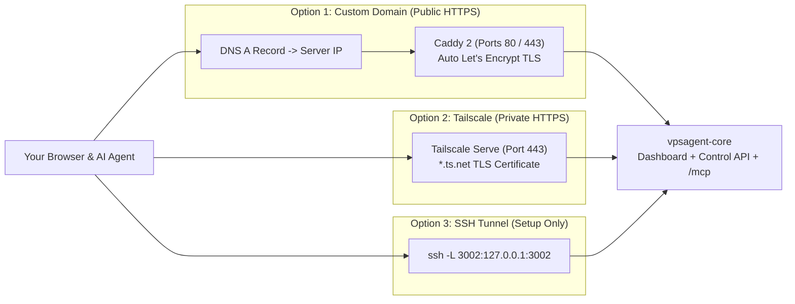

# Getting Started — Install & First-Time Setup

This guide walks you through installing VPSAgent on a fresh **$5 Ubuntu LTS cloud server (VPS)** and completing the 2-step first-time setup. Everything is explained in plain English, with no prior server-management experience required.

---

## 1. What You Need Before You Start

| Requirement | Details |
| :--- | :--- |
| **A fresh Ubuntu LTS VPS** | Ubuntu 22.04 or 24.04 LTS (1 vCPU / 1 GB RAM or more — any $4–$6/month server works). |
| **Root / `sudo` access** | You can log in to your server over SSH as `root` or a user with `sudo`. |
| **One of two HTTPS options** | **Option A:** A domain or subdomain (like `vps.yourdomain.com`) pointed at your server's IP address.<br>**Option B:** **Tailscale** (free private network) — no domain name or DNS records needed! |

> **Firewall ports to allow** (if your cloud provider has an external firewall):
> - **Port `22` (SSH)** — for your terminal connection and initial setup tunnel
> - **Port `80` (HTTP)** & **Port `443` (HTTPS)** — for automatic padlock (`https://`) certificates and public app traffic (not needed if you only use Tailscale)

---

## 2. Choose Your Install Command

Log in to your Ubuntu server via SSH and run **one** of the commands below. The installer automatically sets up Docker Engine, Docker Compose v2, the UFW firewall, the host Runtime Bridge (`vpsagent-runtime.service`), Caddy Auto-TLS, and the VPSAgent dashboard.

### Option A — Standard Install with a Domain (Works for Public or Private Repos)

Clone the repository into your home folder and run the installer with your domain and email:

```bash
git clone git@github.com:VPSAgent/vpsagent.git "$HOME/vpsagent"
sudo bash "$HOME/vpsagent/bootstrap/install.sh" --domain vps.yourdomain.com --email you@yourdomain.com
```

### Option B — Install Without a Domain Yet (SSH Tunnel Setup)

If you haven't pointed a domain yet, run the installer with no flags:

```bash
git clone git@github.com:VPSAgent/vpsagent.git "$HOME/vpsagent"
sudo bash "$HOME/vpsagent/bootstrap/install.sh"
```

At the end, the installer prints a private SSH tunnel command so your first-time password never travels over unencrypted `http://`:

```bash
ssh -N -L 3002:127.0.0.1:3002 root@YOUR_SERVER_IP
```

Then open `http://127.0.0.1:3002/#claim=...` on your own computer.

### Option C — Private HTTPS via Tailscale (No Domain or DNS Needed)

If you don't want to buy a domain or edit DNS records, pass `--tailscale`:

```bash
git clone git@github.com:VPSAgent/vpsagent.git "$HOME/vpsagent"
sudo bash "$HOME/vpsagent/bootstrap/install.sh" --tailscale
```

- **Headless / automated Tailscale sign-in:** Set `VPSAGENT_TAILSCALE_AUTHKEY=tskey-auth-...` before running `sudo -E bash ...` so the server joins your tailnet automatically.
- Once connected, your dashboard and AI doorway are served privately at `https://<machine>.<tailnet>.ts.net` and `https://<machine>.<tailnet>.ts.net/mcp`.

### Option D — One-Line Public Repo Install

When installing from a public repository:

```bash
curl -fsSL https://raw.githubusercontent.com/VPSAgent/vpsagent/main/bootstrap/install.sh | sudo bash -s -- --domain vps.yourdomain.com --email you@yourdomain.com
```

### Installer Flags Reference

| Flag | Description |
| :--- | :--- |
| `--domain <host>` | Optional dashboard domain for automatic HTTPS (e.g. `vps.yourdomain.com`). |
| `--email <email>` | Optional Let's Encrypt certificate notice email. |
| `--tailscale` | Install Tailscale and configure private HTTPS (`*.ts.net`) without needing a domain. |
| `--force` | Overwrite existing config and systemd unit files during reinstall. |
| `--help`, `-h` | Print installer options and exit. |

---

## 3. How the Network & HTTPS Choices Work



---

## 4. Complete the 2-Step First-Time Setup

When you open the private setup link printed by the installer, you'll see a 2-step wizard:

### Step 1: Claim Your Server & Create a Password

Choose a strong password (at least 8 characters). This locks your server so nobody else can claim it. The one-time claim token is automatically consumed as soon as you submit.

### Step 2: Connect Your Domain or Enable Tailscale

Next, choose how you want to reach your dashboard and AI doorway (`POST /mcp`):

- **Custom Domain:** Enter your domain (e.g. `vps.yourdomain.com`) and email. VPSAgent configures Caddy and checks that your live `https://` padlock certificate is active.
- **Tailscale (No Domain):** Click **Connect Tailscale** (or turn on **Tailscale private HTTPS**) to get an instant `https://<machine>.<tailnet>.ts.net` address.

> **You can change or add either option later** inside **Settings → Domains & network** in the dashboard.

---

## 5. What the Installer Places on Your Server

Everything lives cleanly in `/var/lib/vpsagent` and two systemd/Docker services:

| Path / Service | Purpose |
| :--- | :--- |
| `/var/lib/vpsagent/.env` | Auto-generated random secrets (`VPSAGENT_RUNTIME_TOKEN`, `VPSAGENT_SESSION_SECRET`, `VPSAGENT_ENCRYPTION_SECRET`, `VPSAGENT_CLAIM_TOKEN`). Never shared or committed. |
| `/var/lib/vpsagent/data/registry.db` | Built-in SQLite (WAL) database storing your apps, deployments, encrypted secrets, approvals, audit log, and AI visitor passes. |
| `/var/lib/vpsagent/apps/<slug>/` | Isolated folder for each app you deploy (its `docker-compose.yml`, `.env`, and `/app/data` volume). |
| `/var/lib/vpsagent/caddy/apps.d/` | Auto-generated Caddy HTTPS route files for each app with a public domain. |
| `vpsagent-runtime.service` | Host systemd service running `runtime-bridge.py` and listening on `/var/lib/vpsagent/run/runtime.sock`. |
| `vpsagent-core` & `vpsagent-caddy` | Docker Compose containers for the dashboard/API/MCP gateway and Caddy reverse proxy. |

---

**Next:** [How It Works & Security Model →](02-architecture-and-security.md)
